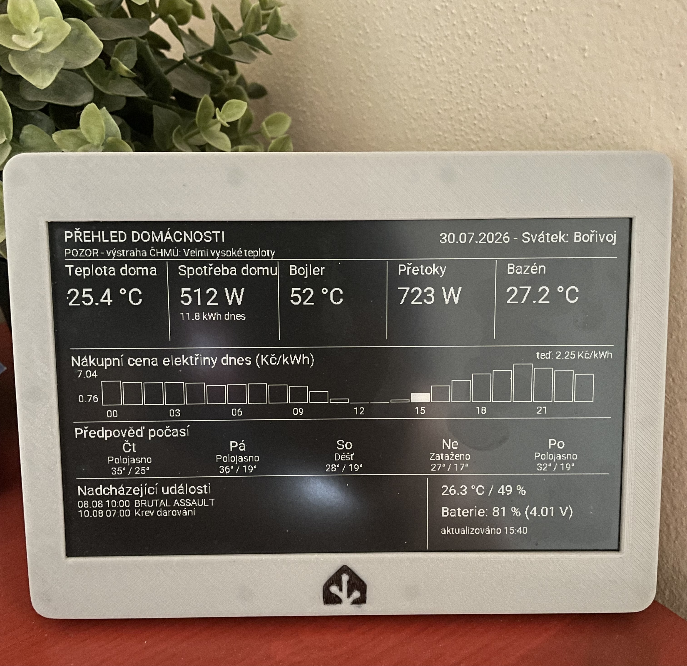

# E-paper dashboard domácnosti (LaskaKit Live-7.5 + ESPHome + Home Assistant)

*[Read this in English](README.md)*

Bateriově napájený 7.5" e-paper displej (800×480, černobílý) zobrazující
přehled domácnosti: vnitřní/venkovní teplotu, aktuální spotřebu a bojler,
přetoky do sítě, spotové ceny elektřiny (24h graf), předpověď počasí na
5 dní, nadcházející kalendářní události, svátek dne a volitelně výstrahu
ČHMÚ. Postaveno na ESPHome a napojené na Home Assistant.

Zařízení běží v hlubokém spánku (`deep_sleep`) a probouzí se jen na pár
sekund každých ~10 minut, aby překreslilo displej a šlo zpět spát - na
jedno nabití baterie tak vydrží týdny až měsíce (podle kapacity baterie
a zvoleného intervalu probouzení).



## Hardware

- **[LaskaKit Live-7.5](https://www.laskakit.cz/laskakit-live-7-5-e-paper-stavebnice-s-wifi-pro---zivy-obraz-/?variantId=13529)**
  kit - e-paper deska **ESPink v3.6** s **ESP32-S3**
  (POZOR: starší revize v2.7/v3.5 mají klasický ESP32, ne S3 - pinout
  se liší, viz níže).
- Panel **Good Display GDEY075T7**, 800×480, černobílý.
- Volitelně: LiPo/Li-ion baterie (jednočlánková, 3.7V) pro bezdrátový provoz.

### Pinout (ESPink v3.6, ESP32-S3)

| Funkce                     | GPIO |
|-----------------------------|------|
| Display CS                  | 10   |
| Display DC                  | 48   |
| Display BUSY (inverted!)    | 38   |
| Display RESET                | 45   |
| SPI CLK                     | 12   |
| SPI MOSI                    | 11   |
| I2C SDA (SHT40 senzor)       | 42   |
| I2C SCL (SHT40 senzor)       | 2    |
| ADC baterie                  | 9    |
| Napájení displeje (LDO, HIGH=zapnuto) | 47   |

## Co potřebuješ v Home Assistant

- Běžící instanci Home Assistant s **ESPHome** add-onem (nebo samostatný
  ESPHome Dashboard).
- Nějaký senzor spotových cen elektřiny s hodinovými/15min atributy
  (např. integrace "Spot Price CZ" nebo podobná).
- Alespoň jeden `calendar.*` entity (Google kalendář, narozeniny, svátky...).
- Funkční `weather.*` entitu podporující `weather.get_forecasts`.
- Volitelně: senzor výstrahy ČHMÚ s atributem `severityLevel` (HACS
  integrace poskytující ČHMÚ výstrahy) - pokud nemáš, jde snadno vypustit.

## Instalace

1. **Zkopíruj `esphome/epaper-dashboard.yaml`** do své ESPHome složky
   (`/config/esphome/` v HA).
2. **Vytvoř `esphome/secrets.yaml`** podle `secrets.yaml.example` a doplň
   vlastní WiFi heslo, API encryption key (vygeneruj na
   https://esphome.io/encryption-key) a heslo záložního AP.
3. **Zkopíruj `packages/ha_spot_price_template.yaml`** do
   `/config/packages/` a v `configuration.yaml` měj:
   ```yaml
   homeassistant:
     packages: !include_dir_named packages
   ```
   (Nerekurzuje do podsložek - soubor musí být přímo v `packages/`.)
4. **Uprav substituce a šablony** pod svoje entity - v obou souborech
   hledej komentáře "PŘIZPŮSOB". Hlavně:
   - entity_id senzorů teploty/spotřeby/bojleru/přetoků/bazénu,
   - seznam kalendářů v `packages/ha_spot_price_template.yaml`,
   - `weather.xxx` entitu pro předpověď,
   - zdrojový senzor spotových cen.
5. **Zkontroluj konfiguraci** (`ha_check_config` / Developer Tools →
   YAML → Zkontrolovat konfiguraci) a **restartuj Home Assistant**
   (u nových trigger-based template senzorů `reload` sám o sobě
   nestačí spolehlivě - viz Troubleshooting).
6. V ESPHome Dashboardu **zkompiluj a nahraj** firmware (poprvé po
   USB, další aktualizace už jdou přes síť/OTA).

## Baterie a deep_sleep

`sleep_duration` (substituce v ESPHome YAML) určuje, jak dlouho zařízení
spí mezi překreslením displeje. Kratší interval = čerstvější data, ale
kratší výdrž baterie (víc probuzení = víc energie na WiFi handshake).
10 minut je rozumný kompromis pro domácí dashboard; 20-30 minut
výrazně prodlouží výdrž, pokud ti nevadí méně aktuální data.

Baterie se na displeji zobrazuje v % i ve voltech - přepočet je hrubá
lineární aproximace vybíjecí křivky jednočlánkové Li-ion/LiPo baterie
(4.2V = 100 %, 3.7V ≈ 40 %, 3.3V = 0 %). Pokud máš jinou baterii/počet
článků, uprav body v `lambda` bloku (`batt_v`/`batt_pct` výpočet).

## Troubleshooting / Časté problémy

Tohle jsou reálné bugy, na které jsme při stavbě tohoto projektu
narazili - ať je nemusíš objevovat znovu.

### Displej zůstává úplně prázdný, žádná chybová hláška v logu
Nejčastější příčina: **špatný `cs_pin`**. Na desce ESPink v3.6 je
štítek "Display:" se dvěma CS piny - `CS: IO10` (primární, pro
jednočipové panely jako GDEY075T7) a `CS2*: IO18` (volitelný druhý
chip-select jen pro dvoučipové varianty). Pokud omylem použiješ 18
místo 10, SPI zápis proběhne "úspěšně" (SPI je jednosměrná sběrnice,
žádné potvrzení), ale displej nikdy nedostane správný signál a zůstane
prázdný - bez jakékoli chyby v logu. Vždy si ověř piny podle ostré
fotky štítku na desce, ne jen podle staršího GitHub návodu (ten často
popisuje starší revizi v2.7/v3.5 s klasickým ESP32).

### `busy_pin` bez `inverted: true`
Pro tenhle konkrétní řadič (7.50inv2 / GDEY075T7) je `inverted: true`
u `busy_pin` **povinné** - bez něj hrozí (podle ESPHome dokumentace)
trvalé poškození displeje. Nekonfiguruj bez otestování na fotce/vzorku.

### `weather.get_forecasts` trvale hlásí "Referenced entities X are
missing or not currently available"
I po restartu HA a i po vyzkoušení šablonovaného `entity_id`. Skutečná
příčina bývá **duplicitní/osiřelá weather entita** - stejná integrace
vytvořená vícekrát, kde jedna instance je "mrtvá" (stejná data, ale bez
živého propojení). Zkontroluj `Nastavení → Zařízení a služby → Entity`,
jestli neexistuje víc podobně pojmenovaných `weather.*` entit té samé
integrace, a použij tu skutečně živou.

### Kalendářová šablona spadne do "unavailable" po restartu
Jinja `sort()` spadne, pokud v jedné sekvenci mícháš "naivní" (bez
časové zóny - typicky celodenní události jako narozeniny/svátky) a
"aware" (s časovou zónou) `datetime` objekty. Řešení: převeď všechny
časy přes `as_local()` **před** uložením do řadicího páru, a samotný
`ev.start` sjednoť přes filtr `| string` (některé kalendáře vrací
datetime objekt místo řetězce).

### Font hlásí "Codepoint 0x____ not found in font"
Vlastní znaková sada (`glyphs:`) obsahuje jen vyjmenované znaky - pokud
název kalendářní události nebo jiný text obsahuje znak, který tam
není (typicky pomlčka "–" en dash, nebo speciální interpunkce), font
se nezkompiluje/nezobrazí správně. Přidej chybějící znak do `cz_glyphs`
řetězce ve `font:` sekci.

### Nejzávažnější: `deep_sleep` vypadá, že "nefunguje" - zařízení
běží pořád vzhůru, i po nahrání firmwaru s deep_sleep

Tohle je netriviální a stálo nás dost času, takže sem patří na první
místo mezi troubleshooting body pro kohokoliv, kdo kombinuje
**ESPHome OTA + deep_sleep**.

**Příznak:** V živém logu (`ESPHome Dashboard → Logs → On the network`)
zařízení vypisuje senzorové hodnoty nepřetržitě, bez očekávaných
~10minutových pauz. Historie senzorů v HA ukazuje aktualizace prakticky
každých pár desítek sekund po celé hodiny, místo krátkých shluků
oddělených dlouhými mezerami.

**Skutečná příčina:** ESPHome má vestavěnou **OTA rollback ochranu**
(komponenta `safe_mode`). Nově nahraný firmware se považuje za dočasný
("pending"), dokud neběží nepřerušeně alespoň `boot_is_good_after`
(výchozí **1 minuta**) od startu - teprve pak se natrvalo označí jako
funkční a bootloader ho příště nahraje bez váhání. Pokud tvůj
`deep_sleep` skript jde spát **dřív** než uplyne tahle lhůta (běžné u
"probuď se, pošli data, jdi spát" flow s během jen několik sekund),
firmware se nikdy neoznačí za funkční. Každé další probuzení z
hlubokého spánku vypadá pro bootloader jako obyčejný reset - a protože
poslední spuštěná verze nebyla nikdy potvrzena, ESP32 při dalším resetu
provede **automatický rollback zpět na předchozí (starou) firmwarovou
verzi**. Navenek to vypadá, že se tvoje nové změny (včetně samotného
zapnutí deep_sleep) vůbec neprojevily - protože zařízení ve skutečnosti
běží na staré verzi, která třeba deep_sleep vůbec neměla.

V logu se to pozná podle hlášky:
```
[W][safe_mode]: OTA rollback detected! Rolled back from partition 'app1'
[W][safe_mode]: The device reset before the boot was marked successful
```

**Řešení:** přidej akci `safe_mode.mark_successful` do svého probouzecího
scriptu **hned po úspěšném připojení k API, PŘED voláním
`deep_sleep.enter`**:

```yaml
script:
  - id: update_and_sleep
    then:
      - switch.turn_on: epaper_power
      - delay: 200ms
      - wait_until:
          condition:
            api.connected:
          timeout: 15s
      - safe_mode.mark_successful   # <-- tohle je ten klíčový řádek
      - delay: 3s
      - component.update: epaper_displej
      - delay: 6s
      - deep_sleep.enter: deep_sleep_1
```

Tím se firmware označí za funkční během pár sekund po startu, ne až po
výchozí 1minutové lhůtě, a rollback ochrana přestane bránit tvému
záměrnému krátkému probuzení. Po opravě jsme na reálném hardwaru
ověřili stovky čistých ~10minutových cyklů bez jediné anomálie.

### Displej po probuzení občas ukáže prázdné/neaktuální hodnoty
Dva různé, ale příbuzné problémy kolem toho, že `homeassistant` senzory a
text_senzory po probuzení z `deep_sleep` nemají žádnou hodnotu
(`has_state() == false`), dokud ji HA znovu nepošle po připojení -
`deep_sleep` je pro ESP32 plný reset, RAM (a tedy i poslední přijatá
hodnota) se maže.

**1) Chybí úplně - "--" místo hodnoty.** Bez cache byl výsledek prázdný
"--", i když HA hodnotu poslal jen o pár sekund později, než se displej
stihl vykreslit. **Řešení:** každá taková hodnota se hned po přijetí
uloží do `globals` proměnné s `restore_value: yes` (přežije `deep_sleep`
přes flash/RTC preference) a při vykreslení se vždy použije tahle cache
- pokud aktuální update dorazil, cache se přepíše čerstvou hodnotou;
pokud ne, zůstane poslední známá. "--" se teď zobrazí jen při úplně
prvním bootu, kdy ještě žádná hodnota nikdy nedorazila. Číselné hodnoty
jsou cachované jako `float` s `NAN` jako sentinel "ještě nikdy
nedorazilo", texty (CSV řetězce) jako pevná `char[]` pole - `std::string`
s `restore_value` by bezpečně uložil jen ukazatel, ne obsah, protože
mechanismus `restore_value` kopíruje jen pevný počet bajtů a nerozumí
heap indirekci.

**2) Proč se to nedoručení dělo i mimo `deep_sleep`.** `wait_until:
api.connected` potvrzuje jen navázané (zašifrované) API spojení mezi
ESP32 a HA - vůbec neříká, že HA už poslal aktuální hodnoty entit zpět.
To je až druhý krok: po handshaku ESPHome pošle HA požadavek na odběr
stavů a HA teprve pak zpětně pošle hodnotu pro každou entitu. Původní
`delay: 3s` mezi `api.connected` a `component.update` na tenhle zpětný
push často nestačil - hlavně když se probuzení displeje časově potkalo
s přepočtem trigger-based šablon v
`packages/ha_spot_price_template.yaml` (běží každých 15 min, volají
pomalejší `calendar.get_events`/`weather.get_forecasts`), nebo při
slabším WiFi signálu. **Řešení:** prodloužen delay mezi `api.connected`
a `component.update` z 3s na 6s (víc prostoru pro HA), následný delay
zkrácen ze 6s na 3s, aby celkový budget probuzení zůstal v mezích
`run_duration` (60s).

Obě opravy se doplňují - cache (1) je pojistka pro zbytkový případ, kdy
i prodloužené okno (2) nestačí (výpadek WiFi, restart HA, vytížení).

## Rozšíření

- **FVE (fotovoltaika):** substituce a sloupec pro výrobu/baterii FVE
  jsou v komentářích v YAML zmíněny jako místo k rozšíření - přidej
  další `homeassistant sensor` + sloupec v `lambda` podle vzoru
  "Spotřeba domu / Bojler".
- **Víc/míň nadcházejících událostí:** uprav `MAX_EVENTS` v ESPHome
  lambdě a `sorted_items[:N]` v `ha_spot_price_template.yaml` - obě
  hodnoty musí sedět, jinak displej dostane oříznutá data bez ohledu
  na to, kolik řádků má místo zobrazit.

## Licence

MIT, viz [LICENSE](LICENSE). Displej ani firmware nejsou oficiální
produkt LaskaKitu - jde o komunitní konfiguraci pro jejich hardware.
